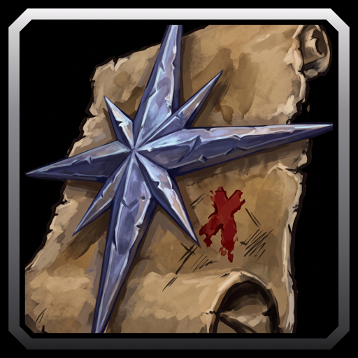

# Questie Guide

A WoW Forever addon that lists every quest you can pick up now, grouped by zone and rated by the XP of one trip through each zone. It reads QuestieDB, Questie's quest database, which the CurseForge app installs with Questie Guide. Questie itself is not needed.

## Features

- A Next banner names the best zone for your next trip.
- Each zone shows its quest count and trip XP.
- Each quest shows only the status that matters, such as In Questlog or Missing Pre-Quest.
- Click a quest to open the map at its giver with a waypoint.
- Quests ready to turn in sit at the top.
- One Filter menu sets quest types, level range and sorting.
- Item tooltips name the quests an item is for.
- A chat line points out new quests when you level up.

## Usage

1. Open it with the minimap button, `/qg` or a key binding.
2. Read the Next banner, or press Current Zone.
3. Type in the search box to find a quest, zone or NPC.
4. Click a quest to open the map at its giver. Shift-click links it in chat.

Commands:

- `/qg minimap` hides or shows the minimap button.
- `/qg reset` moves the window back to the center.
